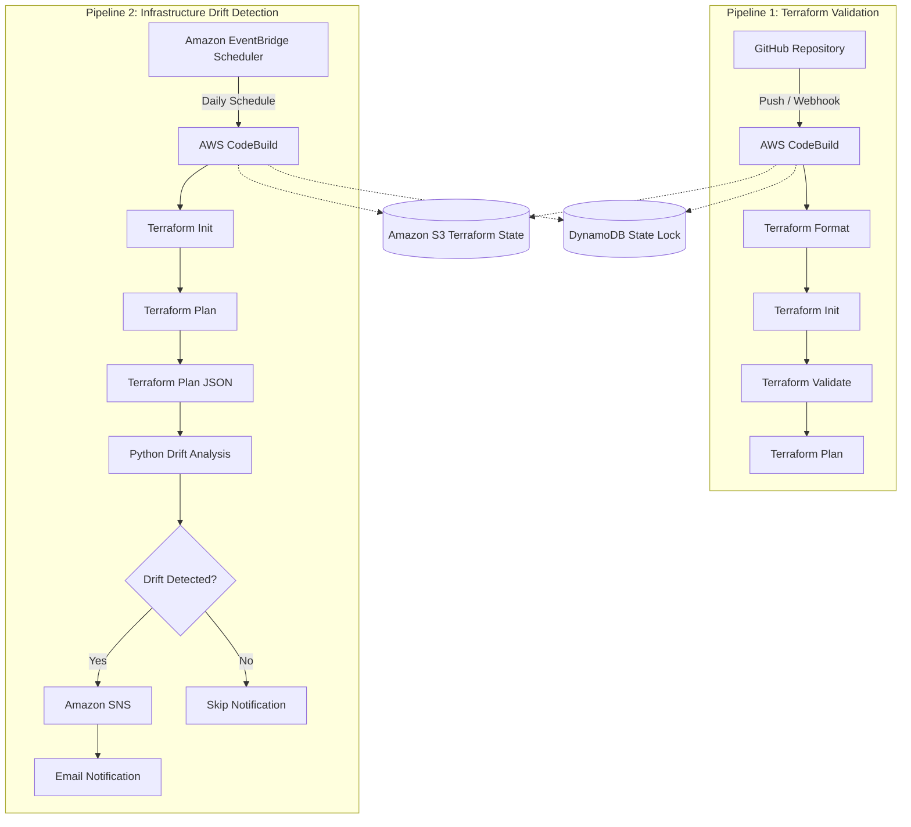

# Automated Terraform Validation and Infrastructure Drift Detection Using AWS CodeBuild

## Overview

This project demonstrates how to automate Terraform validation and detect infrastructure drift using AWS Developer Tools.

It uses AWS CodeBuild to execute Terraform commands, a Python script to analyse Terraform plan JSON output, Amazon SNS to send email notifications when drift is detected, and Amazon EventBridge Scheduler to automate daily drift checks.

The solution consists of two independent pipelines:

1. **Terraform Validation Pipeline** – validates Terraform configuration whenever code changes are pushed to the GitHub repository.
2. **Infrastructure Drift Detection Pipeline** – periodically checks whether the actual AWS infrastructure differs from the previously recorded Terraform state and sends notifications when drift is detected.

## Architecture



## AWS Services Used

| AWS Service | Purpose |
|---|---|
| AWS CodeBuild | Executes Terraform validation and drift detection |
| Amazon S3 | Stores the Terraform remote state |
| Amazon DynamoDB | Provides Terraform state locking |
| Amazon EventBridge Scheduler | Triggers daily drift detection |
| Amazon SNS | Sends email notifications when drift is detected |
| AWS IAM | Provides permissions to the CodeBuild projects and scheduled invocation |

## Repository Structure

```text
learning-repo/
│
├── project-2-terraform-drift/
│   │
│   ├── terraform/
│   │   ├── main.tf
│   │   ├── variables.tf
│   │   ├── outputs.tf
│   │   ├── backend.tf
│   │   └── .terraform.lock.hcl
│   │
│   ├── scripts/
│   │   └── detect-drift.py
│   │
│   ├── buildspec-validate.yml
│   ├── buildspec-drift.yml
│   └── README.md
```

## 1. Terraform Infrastructure

The Terraform configuration provisions an Amazon S3 bucket with the following security configurations:

- S3 bucket versioning.
- Server-side encryption using AES256.
- S3 public access block configuration.

Terraform uses a remote backend to store the state centrally.

**Backend configuration:**

| Setting | Value |
|---|---|
| Backend | Amazon S3 |
| State bucket | `enminto-p2-tfstate-580069881307` |
| State key | `project-2/terraform.tfstate` |
| Region | `ap-south-1` |
| State locking | DynamoDB |
| Lock table | `enminto-p2-terraform-lock` |

The same remote state is used by both CodeBuild projects.

This ensures that validation and drift detection operate against the same Terraform-managed infrastructure.

## 2. Terraform Validation Pipeline

**CodeBuild project:** `project-2-terraform-validate`

The validation pipeline is integrated with GitHub through AWS CodeConnections.

Whenever changes are pushed to the configured GitHub branch, CodeBuild executes the validation workflow.

### Pipeline stages

| Stage | Terraform command | Purpose |
|---|---|---|
| Format | `terraform fmt -check` | Checks Terraform formatting |
| Initialize | `terraform init` | Initializes providers and remote backend |
| Validate | `terraform validate` | Validates Terraform configuration |
| Plan | `terraform plan` | Identifies proposed infrastructure changes |

**Buildspec:** `buildspec-validate.yml`

The pipeline helps identify configuration and validation issues before infrastructure changes are applied.

## 3. Infrastructure Drift Detection Pipeline

**CodeBuild project:** `project-2-terraform-drift-detection`

The drift detection pipeline compares the actual AWS infrastructure with the previously recorded Terraform state.

### Execution workflow

1. CodeBuild initializes Terraform using the existing S3 backend.
2. Terraform generates an execution plan.
3. The plan is converted into JSON format.
4. A Python script analyses the `resource_drift` section of the JSON output.
5. If drift is detected, an SNS notification is published.
6. If no drift is detected, the pipeline completes without sending an email.

### Terraform commands

Generate the Terraform plan:

```bash
terraform plan -input=false -no-color -lock-timeout=5m -out=/tmp/tfplan
```

Convert the plan into JSON:

```bash
terraform show -json /tmp/tfplan > /tmp/tfplan.json
```

The JSON output contains information about resource changes, including the `resource_drift` section.

## 4. Python Drift Analysis

**Script:** `scripts/detect-drift.py`

The Python script reads the Terraform plan JSON and examines the `resource_drift` section.

It identifies:

- Whether infrastructure drift exists.
- The number of affected resources.
- Resource addresses.
- Associated change actions.

### No drift detected

```text
DRIFT_DETECTED=false
No infrastructure drift detected.
```

In this scenario, the pipeline skips SNS notification.

### Drift detected

```text
DRIFT_DETECTED=true
Total drifted resources: 1
Resource: aws_s3_bucket.application
Actions: update
```

The pipeline uses this result to determine whether an SNS notification should be published.

The script also handles missing files, invalid JSON, and malformed drift data.

## 5. Amazon SNS Notifications

**SNS Topic:** `enminto-terraform-drift-alerts`

When the Python script identifies infrastructure drift, the CodeBuild project publishes a message to the SNS topic.

The SNS topic delivers an email notification to the confirmed subscriber.

Example notification subject:

```text
Terraform Infrastructure Drift Detected
```

When no drift is detected, the pipeline skips the notification.

This avoids unnecessary email alerts during normal executions.

## 6. Automated Scheduling with Amazon EventBridge

**Schedule:** `terraform-drift-daily-schedule`

Amazon EventBridge Scheduler is configured to invoke the existing drift detection CodeBuild project automatically.

**Schedule configuration:**

| Setting | Value |
|---|---|
| Schedule type | Recurring |
| Schedule expression | `rate(1 day)` |
| Time zone | Asia/Calcutta |
| Target service | AWS CodeBuild |
| Target action | StartBuild |
| CodeBuild project | `project-2-terraform-drift-detection` |
| Flexible time window | Off |

The schedule invokes the CodeBuild `StartBuild` API once every 24 hours.

This enables periodic infrastructure drift checks without requiring manual execution.

The EventBridge Scheduler execution role provides permission to invoke the designated CodeBuild project.

## 7. IAM Permissions

Separate IAM roles are used for the CodeBuild projects.

The Terraform validation role provides the permissions required to:

- Access the Terraform remote state.
- Read and update the DynamoDB state lock.
- Write CodeBuild logs.
- Access the required AWS resources during validation.

The drift detection role additionally provides permission to publish notifications to the configured SNS topic.

EventBridge Scheduler uses its execution role to invoke the CodeBuild project's `StartBuild` API.

Permissions are scoped to the resources required by each component.

## 8. Testing and Validation

The solution was tested using two scenarios.

### Scenario 1: Infrastructure drift detected

An infrastructure difference was identified between the Terraform state and the actual AWS configuration.

The Terraform plan JSON contained resource drift information.

**Expected result:**

- Python identifies the drift.
- The pipeline reports `DRIFT_DETECTED=true`.
- SNS publishes an email notification.

**Result:** Successfully tested. SNS notification was published.

### Scenario 2: No infrastructure drift

After reconciling the Terraform state using a refresh-only operation, the drift detection pipeline was executed again.

Terraform reported:

```text
No changes. Your infrastructure matches the configuration.
```

The Python script returned:

```text
DRIFT_DETECTED=false
No infrastructure drift detected.
```

**Expected result:**

- Python identifies that no drift exists.
- The pipeline reports `DRIFT_DETECTED=false`.
- SNS notification is skipped.

**Result:** Successfully tested.

## 9. Key Takeaways

This project demonstrates practical integration of AWS Developer Tools with Terraform:

- Automating Terraform validation using AWS CodeBuild.
- Managing Terraform remote state using Amazon S3.
- Implementing state locking using DynamoDB.
- Detecting infrastructure drift through Terraform plan JSON.
- Using Python to analyse infrastructure changes.
- Sending conditional notifications using Amazon SNS.
- Scheduling recurring drift checks using Amazon EventBridge Scheduler.
- Applying least-privilege IAM permissions for individual components.

## Conclusion

This implementation provides a lightweight approach to Terraform validation and infrastructure drift detection using AWS-native services.

By combining AWS CodeBuild, Terraform, Python, Amazon SNS, and Amazon EventBridge Scheduler, infrastructure validation and periodic drift monitoring can be automated without introducing additional compute services such as AWS Lambda.

The solution can serve as a foundation for teams looking to improve infrastructure consistency and visibility into changes made outside Terraform.

---

**Technologies:** AWS CodeBuild | AWS CodeConnections | Terraform | Python | Amazon S3 | DynamoDB | Amazon SNS | Amazon EventBridge Scheduler | AWS IAM | GitHub